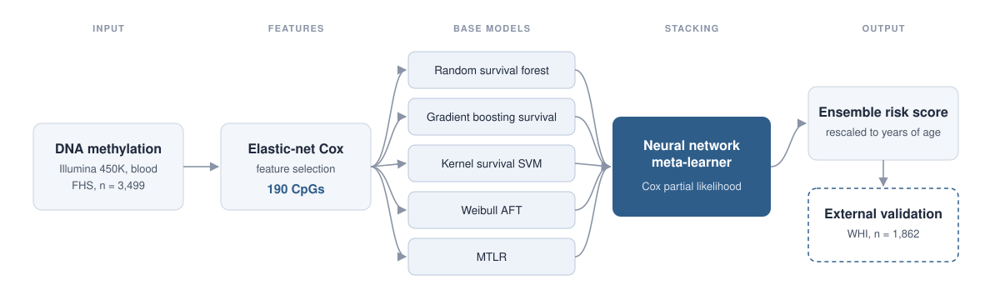

# Ensemble DNA methylation survival clock

This repository contains the code and trained model for an ensemble DNA methylation clock that predicts all-cause mortality. Five survival models built on 190 CpGs, selected by elastic-net Cox regression, are combined by a neural network meta-learner. The model was trained in the Framingham Heart Study and validated in the Women's Health Initiative.

<p align="center">
  
</p>

## Usage

1. **feature_selection.ipynb** splits the FHS data into training (60%), validation (20%) and test (20%) sets, standardises the CpGs on the training set, and selects CpGs with cross-validated elastic-net Cox regression. The list used in the paper is included as `coxnet_selected_cpgs_190.csv`.
2. **ensemble_stacking_pipeline.ipynb** trains the five base survival models (random survival forest, gradient boosting, kernel survival SVM, Weibull AFT and MTLR) and the neural network meta-learner, then rescales the ensemble risk score to years of age. After the first cell has run, set `RUN_ID` in the later cells to the run folder it created.
3. **run_inference.ipynb** loads the trained ensemble from `pretrained_models/` and scores new samples.

## Scoring your own samples

Run the cells in `run_inference.ipynb`, then pass a table with one row per sample and one column per CpG (beta values):

```python
import pandas as pd

df = pd.read_csv("my_methylation.csv")
predictions = pipeline.predict(df)
```

The output contains the ensemble risk score (`ensemble_risk`), the score rescaled to years (`calibrated_age_pred`) and the prediction of each base model. If the input has an `age` column, `age_acceleration` is added. CpGs missing from the input are set to 0.5.

The rescaled score is a mortality risk score expressed on an age scale, not an estimate of biological age.

## Requirements

- Python 3.9 with TensorFlow 2.10
- scikit-learn, scikit-survival, lifelines, PyTorch, pycox, torchtuples, numpy, pandas, pyarrow, h5py and joblib
- Jupyter

Exact versions are pinned in [requirements.txt](requirements.txt).

## Data

The FHS (phs000007.v35.p1) and WHI (phs000200.v12.p3) data are controlled-access and are not included. Access can be requested through [dbGaP](https://www.ncbi.nlm.nih.gov/gap/).

The training notebooks read parquet files from a `data/` folder: one row per participant, with an ID, age, sex, follow-up time in years, a death indicator (`event`) and one column per CpG (beta values). Scoring new samples with `run_inference.ipynb` needs only the CpG columns.

## Getting started

1. Clone the repository:
   ```bash
   git clone https://github.com/dante-yg/Ensemble-Survival-Clock.git
   cd Ensemble-Survival-Clock
   ```
2. Create an environment and install the packages:
   ```bash
   conda create -n ensemble-clock python=3.9
   conda activate ensemble-clock
   pip install -r requirements.txt
   ```
3. Start Jupyter from the repository folder and open `run_inference.ipynb`:
   ```bash
   jupyter notebook
   ```

## Citation

If you use this code or model, please cite:

Muthukumar YG, Vijayakumar KA, Cho GW. Ensemble DNA methylation clock demonstrates immune-metabolic aging signatures associated with mortality. *Mechanisms of Ageing and Development*. 2026;233:112240. https://doi.org/10.1016/j.mad.2026.112240

## License

This project is licensed under the MIT License. See [LICENSE](LICENSE).
